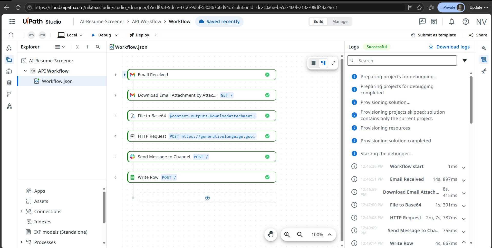
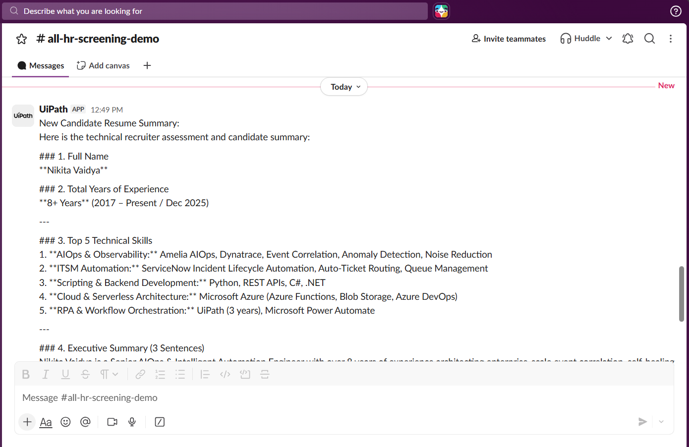
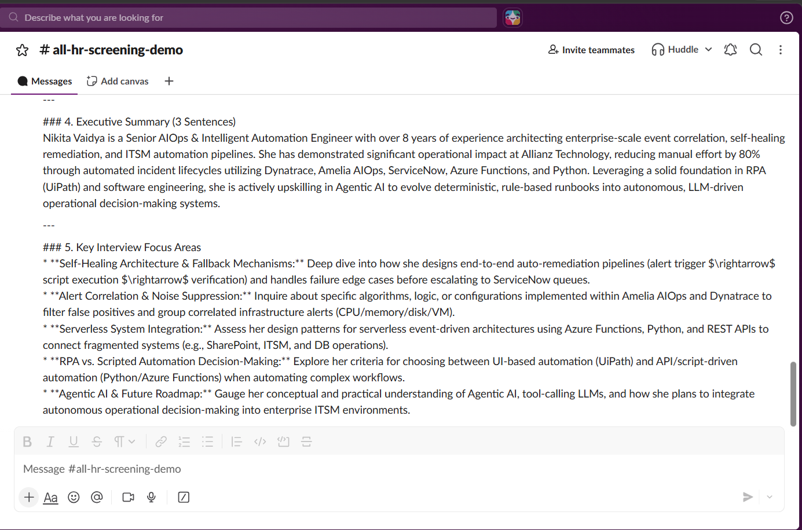
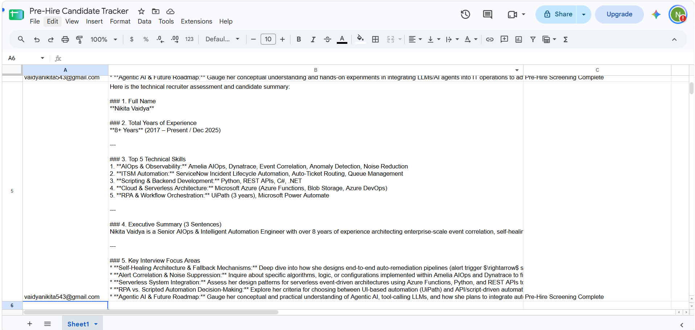

# 🤖 Autonomous AI Resume Screening & HR Pre-Hire Pipeline

An event-driven, serverless Intelligent Document Processing (IDP) workflow built with **UiPath Studio Web (API Workflows)** and **Google Gemini 3.8 Flash Multimodal API**. It automates end-to-end candidate resume triage from email ingestion to recruiter Slack briefings and pre-hire tracking.

---

## 🏗️ System Architecture

```text
[Gmail Trigger] ──▶ [Download PDF] ──▶ [File to Base64] ──▶ [Gemini 3.8 Flash API] ──▶ [Slack Alert] + [Google Sheets Log]
```

### How It Works
1. **Event-Driven Trigger (`Gmail Integration Service`):** Listens in real time for incoming interview applications matching the subject filter `"Please interview"` with attachments.
2. **Binary Extraction & Serialization (`Download Attachment` + `File to Base64`):** Downloads the candidate's PDF resume (`IResource`) and encodes the binary stream into Base64 (`serializeData()`) for REST transmission.
3. **Multimodal LLM Extraction (`HTTP Request` -> `Gemini 3.8 Flash`):** Sends the Base64 PDF payload (`inlineData`) alongside a technical recruiter system prompt—extracting structured candidate insights without brittle regex or layout-specific OCR templates:
   * Full Name & Total Years of Experience
   * Top 5 Technical Skills
   * 3-Sentence Executive Summary
   * Tailored Technical Interview Focus Areas
4. **Human-in-the-Loop Alerting (`Slack Connector`):** Posts a formatted candidate brief directly to the hiring team's Slack channel (`#hr-screening-demo`).
5. **System-of-Record Sync (`Google Sheets Connector`):** Appends the candidate's email, AI summary, and `Pre-Hire Screening Complete` status to a live tracking sheet.

---

## 🛠️ Tech Stack
* **Orchestration:** UiPath Studio Web (API Workflows / Serverless Workflow Spec)
* **AI / Multimodal LLM:** Google Gemini 3.8 Flash REST API (`generateContent`)
* **Integrations:** UiPath Integration Service (Gmail, Slack, Google Sheets)
* **Data Formats:** JSON, Base64 Binary Serialization

---

## 📸 Live Execution & Outputs

### 1. UiPath Studio Web Execution Canvas & Logs


### 2. Automated Recruiter Brief in Slack



### 3. Pre-Hire Candidate Tracker in Google Sheets


---

## 🚀 Setup & Reproduction
1. Import [`API Workflow-Workflow.json`](API%20Workflow-Workflow.json) into **UiPath Studio Web** as an **API Workflow**.
2. Configure Integration Service connections for **Gmail**, **Slack**, and **Google Sheets**.
3. Obtain a free API key from [Google AI Studio](https://google.com) and update the `URL` parameter in the `HTTP Request` activity (`?key=YOUR_GEMINI_API_KEY`).
4. Click **Deploy** to run automatically on incoming candidate emails.
